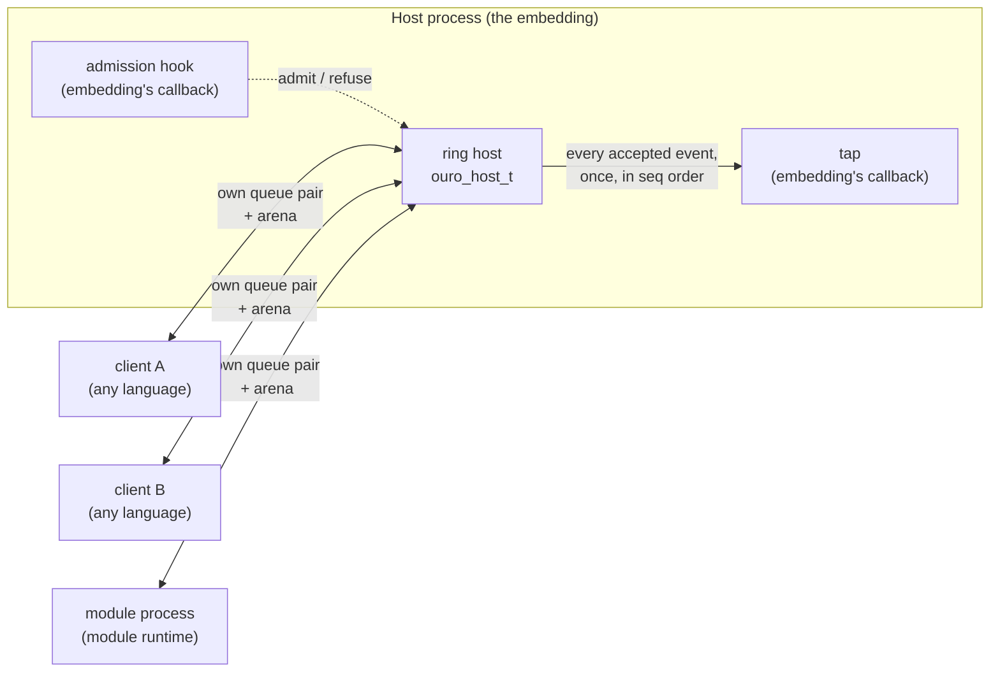
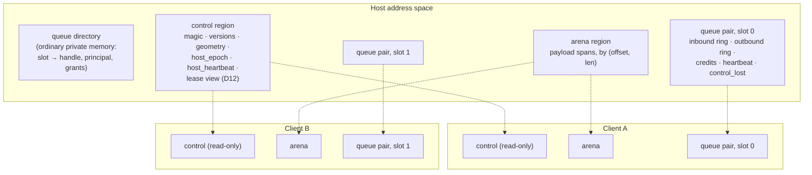
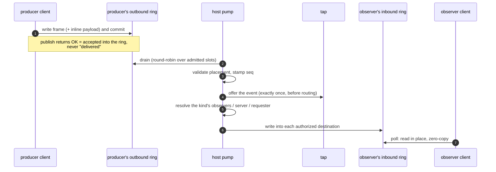
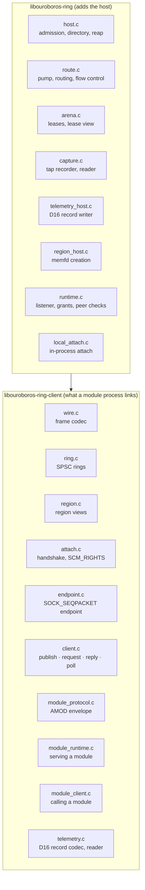

# Architecture

The ouroboros ring moves typed events between separate programs on one Linux
host through shared memory. This page is the map: who the participants are,
what memory each one can reach, how an event travels, and where each part
lives in the reference implementations. The normative rules are in
[`spec/`](../spec/README.md); where this page and the spec disagree, the spec
wins, and where the spec and [`vectors/`](../vectors/) disagree, the vectors win.

## Participants

- **The host** is one participant per ring. It owns every region, admits
  clients, stamps each accepted event with the host sequence, offers it to the
  tap, and routes it. It is the only participant that reads or writes more than
  one client's queues. Only the C implementation has a host.
- **A client** is any admitted program. It maps the control region read-only,
  the shared arena, and its own queue pair, and nothing else. It publishes by
  writing its outbound ring and receives by reading its inbound ring. Clients
  never talk to each other directly; every event goes through the host.
- **A module process** is a client that serves request stages through the
  module runtime: the runtime attaches, validates the AMOD envelope, applies
  deadlines and cancellation, and calls the module's handler.
- **A module caller** is the client side of the same contract: it encodes a
  call, waits for the correlated reply, and maps the outcome to a typed result.

What the ring does not decide is the embedding's: which event kinds exist and
what their payloads mean, who may attach and with what grants, what the tap does
with the stream, durability, and anything that crosses machines
([spec: what it does not own](../spec/README.md#what-it-does-not-own)).

## Memory

A ring is several anonymous `memfd` regions rather than one shared segment, so
the kernel, not the client library, decides what a client can see
([D1](../spec/decisions.md#d1-segment-access-multiple-memfds-not-one-named-segment)).

| Region | Backing | Host | Each client | Holds |
|---|---|---|---|---|
| Control | one `memfd` | read/write | read-only | magic, `spec_version`, `layout_version`, flags, `slot_size`, `inline_budget`, `arena_size`, `host_epoch`, `host_heartbeat`, and the lease view |
| Queue pair | one `memfd` per admitted slot | read/write | read/write, its own slot only | inbound and outbound SPSC rings, credit counters, the client heartbeat, the sticky `control_lost` flag |
| Arena | one `memfd` | read/write | read/write | payloads too large to travel inline |
| Queue directory | not a region | private | none | which slot is whom, principals, grants, pending requests |

Because a client receives exactly three descriptors at attach (control, arena,
its own queue pair) it cannot map another client's rings, cannot enumerate other
slots, and cannot write the geometry its peers read. Those properties are
enforced. Arena bounds are not: every client maps the arena read-write for
zero-copy fan-out, so staying inside one's leases is a contract the client
libraries keep and conformance checks, not something hardware enforces
([D2](../spec/decisions.md#d2-threat-model)).

## How an event travels

1. The producer writes a 64-byte frame header plus its payload into the next
   slot of its own outbound ring and commits. A small payload sits inline in the
   slot; a larger one lives in an arena lease the frame references
   ([arena payloads](arena-payloads.md)).
2. The host drains outbound rings. It overwrites `src_handle` from the slot the
   frame came from, checks the frame's placement against the live geometry, and
   stamps `seq`, the host-wide order that capture and replay use.
3. If telemetry is on, the host first writes the event's content-free record
   into the telemetry ring, which one exporter process drains off the host
   ([telemetry](telemetry.md), [D16](../spec/decisions.md#d16-tap-telemetry-leaves-the-host-the-moment-an-event-is-stamped)).
   Then it offers the event to the tap exactly once, before any routing
   decision, so the tap sees the intended stream in total order
   ([D6](../spec/decisions.md#d6-the-tap-records-the-intended-stream-sheds-are-events)).
4. The host routes by pattern: a notification to the kind's subscribed
   observers, a request to the kind's single server (or a synthesized
   `capability_absent` reply if none is ready), a reply back to the requester
   only, a cancel to the server. See [routing and flow control](routing-and-flow-control.md).
5. Each destination reads the event in place from its inbound ring. The payload
   pointer stays valid until that client's next poll.

The host's pump is a function, `ouro_host_pump`, that drains every outbound ring
once and returns. The ring starts no thread for it: the embedding decides when
to pump, under the same lock it uses for attach and reap, and sleeps between
pumps in `ouro_host_wait`. Every client sleeps on its own doorbell the same way,
and where both ends hold a process handle on each other there are no heartbeats
either, so an idle ring makes no wakeups at all
([sleeping and waking](routing-and-flow-control.md#sleeping-and-waking)).

## Lifetimes and liveness

- **Process handles** ([D15](../spec/decisions.md#d15-liveness-is-the-process-not-a-timer)).
  The runtime listener opens a handle (a pidfd on Linux) on each process it
  admits, and releases that process's slot the moment it exits. Such a slot is
  granted process liveness and needs no heartbeat, as is a client attached in
  the host's own process (`ouro_host_attach_local`). A client likewise watches
  the host's process, and the host's exit reads as an epoch change.
- **Detach** is announced: a detaching client marks its heartbeat
  `OURO_HEARTBEAT_DETACHED` and rings the host, whose next pump releases the slot.
- **Heartbeats** remain for a client the host holds no handle on. The client
  advances the heartbeat in its queue pair; the host reaps a slot whose
  heartbeat stops advancing (`ouro_host_reap`, or `ouro_runtime_maintain` when
  the runtime owns the listener, which `ouro_runtime_maintenance_due` says is
  needed). Releasing a slot, by any of these, frees its arena references.
- **`host_epoch`** changes when the host restarts or bumps it. Every handle and
  mapping from the old epoch is invalid; clients observe the change and
  re-attach. Events the host had not stamped are lost: the ring is not a
  durability boundary.
- **Loss is never silent.** A shed delivery, a producer reaped with an event in
  flight, and a destination reaped mid-delivery each produce a typed,
  sequenced event (`overflow`, `producer_reaped`) that the tap sees.

## Where the code lives

The C reference implementation builds two libraries
([D7](../spec/decisions.md#d7-where-the-ring-links-is-the-consumers-decision)):

The client library carries no host, routing, arena allocator or capture code,
so a program that links only it cannot become a host. `scripts/check_single_host.sh`
keeps it that way across all three languages: exactly one translation unit
defines `ouro_host_create`, only `region_host.c` calls `memfd_create`, and the Go
and Rust code creates no regions and accepts no attaches.

| Path | What it is |
|---|---|
| `c/include/ouroboros/` | the public C headers, every name prefixed `ouro_` / `OURO_` |
| `c/src/` | the C host and client |
| `c/conformance/` | the conformance host and the module-runtime harness other implementations are tested against |
| `c/tests/`, `c/bench/` | the C tests and the dispatch-overhead benchmark |
| `go/ring/` | the Go client, module caller and module runtime (pure Go, no cgo) |
| `rust/` | the Rust client, module caller and module runtime (depends only on `libc`) |
| `go/cmd/ouroboros-ring-otlp/` | the reference telemetry exporter (D16) |
| `spec/`, `vectors/` | the contract: prose and the frozen numbers |

## Further reading

- [Attach and admission](attach-and-admission.md): the handshake, grants, and
  the runtime listener.
- [Routing and flow control](routing-and-flow-control.md): patterns,
  backpressure, overflow and reaping.
- [Module calls](module-calls.md): the AMOD envelope, the module runtime and the
  module caller.
- [Arena payloads](arena-payloads.md): large payloads and leases.
- [Capture](capture.md): the tap recorder and the capture format.
- [Telemetry](telemetry.md): every stamped event described off the host, and
  the exporter that sends it.
- [Implementations and conformance](implementations-and-conformance.md): the
  three implementations and how a new one is proven.
- [Versions and releases](versions-and-releases.md): what each version number
  means and how a consumer pins the ring.
