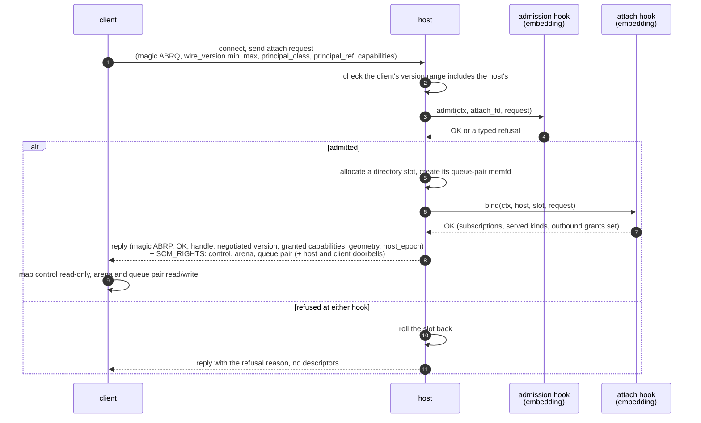
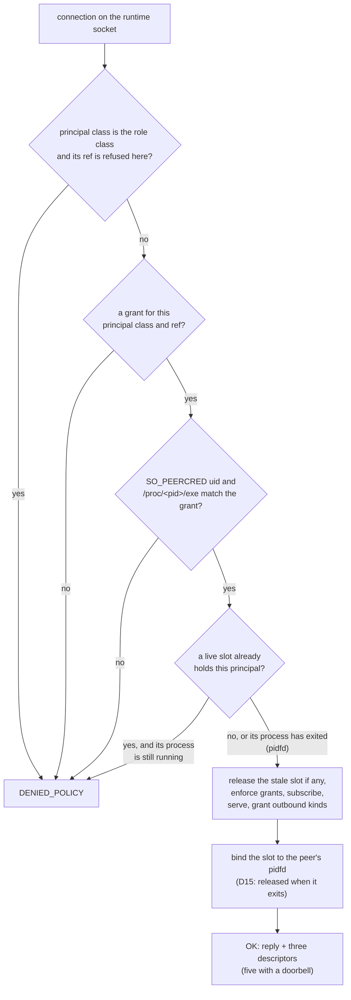

# Attach and admission

Nothing about a ring is open. Its regions are anonymous `memfd`s with no name in
any filesystem, so a process that has not been admitted has nothing to open,
map or enumerate. The only way in is the attach handshake, and the host's
embedding decides who passes it ([R4](../spec/README.md#requirements)).

## The handshake

Attach runs over a `SOCK_SEQPACKET` Unix socket. It is the only use of a socket
in the ring; once it completes, every event moves through shared memory.



- **Request.** `ouro_attach_request_t`: the `ABRQ` magic, the range of wire
  versions the client speaks, and the principal it claims to be. The claim is
  only a claim until the admission hook checks it.
- **Version.** The spec lets a host and client settle on the highest version
  both support. The C host speaks one wire version (3): it accepts a client whose
  range includes it and refuses any other with `DENIED_VERSION`.
- **Admission.** The embedding's `ouro_admit_fn` receives the connected socket
  as well as the request, so it can bind the claimed principal to an
  authenticated OS peer before trusting it. A refusal is `DENIED_POLICY`; a full
  directory, or a slot whose regions cannot be created, is `DENIED_NOSLOT`.
- **Binding.** After a slot exists but before any descriptor leaves the host,
  the attach hook (`ouro_host_set_attach_hook`) registers what this client may
  do: the kinds it observes, the kinds it serves, and the fresh notifications
  and requests it may send. If binding fails, the slot is rolled back and
  nothing is granted.
- **Reply.** `ouro_attach_reply_t` carries the outcome, the client's handle,
  the negotiated wire version, the geometry (`slot_size`, `inline_budget`,
  `queue_capacity`, `arena_size`) and the `host_epoch`. On success it travels
  with three descriptors, in this order, in one `sendmsg`: control, arena, the
  client's queue pair. A client that asked for a doorbell
  (`OURO_ATTACH_CAP_DOORBELL` in the request's `capabilities`) and was granted
  one, as the reply's `capabilities` says, receives two more: the host doorbell
  and its own
  ([D13](../spec/decisions.md#d13-doorbells-idle-ends-sleep-in-the-kernel)).
  The request is 20 bytes; a host also accepts the 16-byte request that predates
  `capabilities`, and an older host reads only those 16 bytes of a newer one.
  `OURO_ATTACH_CAP_PROCESS_LIVENESS` (bit 1) is granted when the attach hook
  bound the slot to the client's process (`ouro_host_bind_process`), and tells
  the client it need not heartbeat
  ([D15](../spec/decisions.md#d15-liveness-is-the-process-not-a-timer)).

The client reads its geometry from the reply and the control region. It is
never compiled against those values, which is why the host can re-tune them
without a new layout version
([D4](../spec/decisions.md#d4-slot-size-and-inline-budget-control-region-parameters-not-wire-fields)).

## Who decides what

The ring owns the mechanism: the handshake, slot allocation, the descriptor
grant, enforcement of the grants it was given, and reaping. The embedding owns
the policy: who may attach, as which principal, with which kinds. The two meet
at three seams on `ouro_host_t`:

| Seam | Set with | Decides |
|---|---|---|
| admission | `ouro_host_create` / `ouro_host_set_admission` | whether this peer may attach as this principal |
| capability binding | `ouro_host_set_attach_hook` | what an admitted slot observes, serves and may send |
| outbound grants | `ouro_host_enforce_grants`, `ouro_host_grant_outbound` | which fresh notifications and requests a governed slot may inject |

A governed slot that sends a notification or request its grants do not name is
refused with a `capability_denied` control event; replies and cancels need no
grant, because the host authorizes them from its own table of pending requests.

## The runtime listener

Most embeddings want the same policy, so the C host library ships one:
`ouro_runtime_start` (`<ouroboros/runtime.h>`). It listens on a fresh socket
path, installs itself as both hooks, and accepts on its own thread under a lock
the embedding shares with every other host mutation.



A grant is one file per installed program in a policy directory
(`ouro_runtime_policy_load_dir`); a missing directory is an empty policy, under
which the listener runs and refuses everyone:

```text
version=1
principal_class=1
principal_ref=17
uid=self
executable=/usr/libexec/example/module-providers
publish=
subscribe=
request=
serve=4353,4354
```

`uid=self` means the daemon's own effective uid. `executable` must be absolute
and must equal the peer's `/proc/<pid>/exe`. The four kind lists say what the
slot may publish, observe, request and serve.

The listener also handles the case heartbeats alone handle badly. A process that
crashes cannot detach its slot, and its supervisor may restart it at once. When
the kernel supports `pidfd`, the runtime keeps a handle on each admitted
process: a new attach for a principal whose previous holder has exited releases
the stale slot immediately, while a live duplicate is still refused. Without
`pidfd` the stale slot waits for heartbeat reaping. `ouro_runtime_maintain`,
called periodically under the host lock, advances the host heartbeat and reaps
slots whose client heartbeat has stopped.

`refused_role_refs` lets a host that composes several ring instances refuse
role identities that belong to another instance, so a role cannot attach where
it does not belong. Which role refs exist is the embedding's business.

## Attaching in the same process

A host that runs some of its own clients, such as an observability consumer or
an in-process module, attaches them with `ouro_host_attach_local`
(`<ouroboros/local_attach.h>`). It is the ordinary handshake over a private
socketpair whose host end is served on a short-lived thread; nothing on the wire
distinguishes it from any other attach. With `owned` set it goes through
`ouro_host_serve_attach_owned`, which accepts only a kernel-verified peer in the
same process and user, and which the caller must invoke while holding its host
lock. This is a convenience of the C implementation, not part of the contract.

## Detach, reap and restart

- A client that is done calls `ouro_client_detach` (or its Go and Rust
  equivalents) and closes its socket.
- A client whose heartbeat stops is reaped. Reaping drops every arena reference
  the slot holds, discards its rings, and frees the slot. An event that was
  blocked in flight for a reaped producer becomes a `producer_reaped` record.
- `ouro_host_bump_epoch` (or a host restart) changes `host_epoch`. Every
  client sees `epoch_changed`, every mapping is stale, and clients re-attach.
