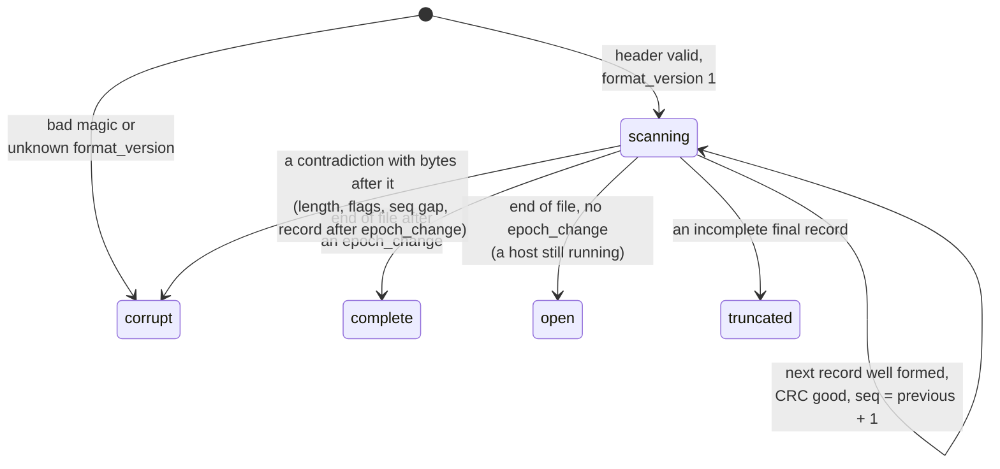

# Capture

Because the host offers every accepted event to its tap exactly once, in `seq`
order, before routing, the tap stream is a complete record of what the ring was
asked to do. Capture writes that stream down. The format is normative
([D10](../spec/decisions.md#d10-the-v0-capture-stream-format)); this page is how
the C implementation produces and reads it (`<ouroboros/capture.h>`, host
library only).

## Recording


```c
ouro_capture_t cap;
ouro_capture_init(&cap, spec_version, layout_version, host_epoch);
ouro_host_set_tap(&host, ouro_capture_tap, &cap);

/* ... later, whenever the embedding decides to persist ... */
uint64_t written = 0;
switch (ouro_capture_flush_fd(&cap, fd, &written, 64u << 20)) {
case OURO_CAPTURE_FLUSHED:       break;            /* every pending byte reached fd */
case OURO_CAPTURE_FLUSH_LIMIT:                     /* would pass the byte limit */
case OURO_CAPTURE_FLUSH_WRITE_FAILED:              /* the file is cut short */
case OURO_CAPTURE_FLUSH_BROKEN:  /* stream abandoned */ break;
}
```

- The tap records every event as one record: host-generated `overflow`,
  `producer_reaped` and `epoch_change` get their own record types, everything
  else is an `event` record.
- **Payloads are materialized.** The record keeps the frame header verbatim,
  including its original `payload_ref`, and appends the payload bytes. For an
  arena payload the host reads the producer's span once, before routing, which is
  the only place the host reads arena bytes. A reader must use those bytes and
  never dereference `payload_ref`, which names an arena that no longer exists.
- **One file is one stream.** `ouro_capture_flush_fd` appends what is pending,
  empties the sink and remembers that the header is written, so any number of
  flushes produce one `seq`-contiguous file. `written` is the file's running byte
  count, checked against `limit` (0 for none) before anything is written.
- **Failure stops the stream cleanly.** If a flush would pass the limit or a
  write fails, the sink is marked broken and the tap stops appending, so the file
  reads as truncated, never as corrupt. What a lost stream means is the
  embedding's decision; the ring only reports it.
- The tap has to keep up: the contiguity guarantee assumes a record is durable
  before the host stamps the next `seq`. An embedding that flushes in batches is
  choosing how much of the tail a crash can lose.

## The format

All integers little-endian.

**File header, 64 bytes:** `magic` (the eight bytes `AIMEECAP`, kept from before
the ring had its own name so that older captures stay readable),
`format_version` 1, `header_len` 64, flags, the ring's `spec_version` and
`layout_version`, `host_epoch`, `first_seq`, a wall-clock creation time (for
people; order comes from `seq`) and reserved bytes.

**Record:**

```text
 0      4      6      8                          8 + 64        8 + 64 + payload_len
 +------+------+------+--------------------------+---------------------+--------+
 | len  | type | flags| ring frame header (64 B) | payload bytes       | crc32c |
 +------+------+------+--------------------------+---------------------+--------+
```

`record_len` is always `8 + 64 + payload_len + 4`, where `payload_len` is the
embedded frame's own field; the CRC-32C covers every byte before it. An
`epoch_change` record carries a 16-byte body (old epoch, new epoch) and must be
the last record in its stream.

## Reading

`ouro_capture_read` classifies a byte stream from its bytes alone and, unless it
is corrupt, replays each record to a callback in order:



| Status | Meaning |
|---|---|
| `COMPLETE` | ended cleanly with `epoch_change` |
| `OPEN` | a valid capture of a host that is still running |
| `TRUNCATED` | the last record is incomplete; the report gives the last good `seq` and the offset |
| `CORRUPT` | a structural contradiction before the end |

These describe the bytes, not what happened to them: a reader cannot know
whether a file was interrupted or damaged. The rules are chosen so an
interrupted write reads as `TRUNCATED` and a structural impossibility as
`CORRUPT`, and only the final record can ever be truncated. The report carries
the number of records parsed, the last good `seq`, the offending offset and the
rule that fired.

Replay here is observational: it re-presents the recorded stream and executes
nothing, so it is exact by construction. Driving a module again against its
recorded inputs is not part of the ring.
