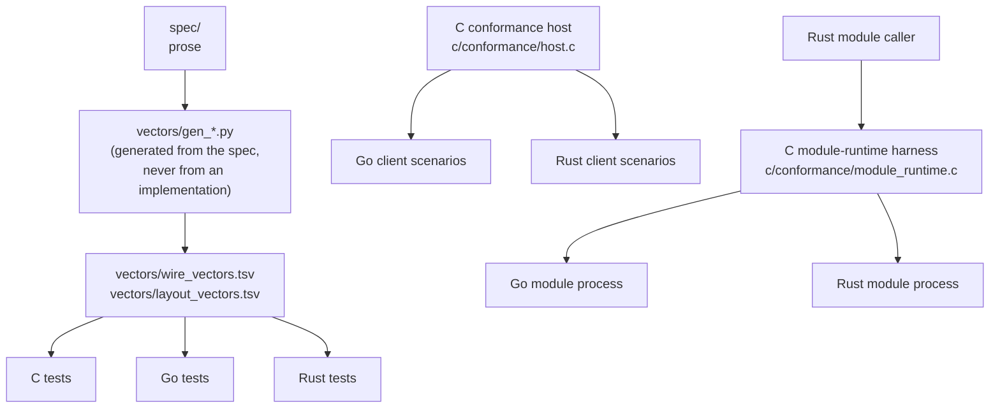

# Implementations and conformance

The ring is a contract first. The C, Go and Rust code in this repository are
reference implementations of it: usable as they are, and held to the contract
by the same evidence a new implementation in any other language would have to
produce. None of them links, imports or generates code from another
([R1](../spec/README.md#requirements)), so when they agree, that is evidence
about the contract rather than one codebase agreeing with itself.

## What each implementation provides

| | C (`c/`) | Go (`go/ring`) | Rust (`rust/`) |
|---|---|---|---|
| Host: regions, admission, routing, arena allocation, capture | yes, the only one | no | no |
| Client: attach, publish, request, reply, cancel, poll | `ouro_client_*` | `ring.Client` | `client::Client` |
| Reading arena payloads in place (D12) | yes | yes | yes, copied out at once |
| Module runtime (serving stages) | `ouro_module_process_run` | `ring.RunModuleProcess` | `run_module_process` |
| Module caller (calling stages) | `ouro_module_client_call` | `ring.ModuleCaller`, `ring.ConcurrentModuleCaller` | `ModuleCaller` |
| Runtime listener and grant files | `ouro_runtime_*` | no | no |
| Dependencies | libc, pthreads | `golang.org/x/sys/unix`, no cgo | `libc` only, no build script |

There is exactly one host so that every client has to meet the same one.
`scripts/check_single_host.sh` holds that line: `ouro_host_create` is defined in
one translation unit, `memfd_create` is called only from
`c/src/region_host.c`, and no Go or Rust source creates regions, binds, listens
or accepts attaches.

## The evidence

1. **Vectors.** `vectors/wire_vectors.tsv` freezes frame bytes, including
   negative rows a decoder must refuse; `vectors/layout_vectors.tsv` freezes
   every region, ring, lease-view, attach and AMOD offset, size, magic and
   version a client needs. Each implementation checks them in both directions:
   every row must match what it does, and every layout constant it uses must
   have a row. The tables come from generators that read the specification, and
   `vectors/check_vectors_current.py` fails if a committed table and its
   generator disagree. Regenerating them is a deliberate, reviewed change.
2. **The conformance host.** `ouroboros-ring-conformance-host` runs the C host
   with one internal C client and accepts one external client. The external
   client proves both directions: it publishes a notification the C client
   answers, has a request echoed, draws a synthesized `capability_absent`, reads
   arena notifications of 1, 193, 5000 and 60000 bytes through the lease view and
   returns the references, serves an arena-placed request, and receives an
   arena-placed reply. A stats request then shows the producer's live leases have
   drained.
3. **The module-runtime harness.** `ouroboros-ring-module-runtime-harness
   MODULE_BINARY` drives a module process written in another language with the C
   module caller. With `OURO_TEST_MODULE_CALLER` set, it also runs that
   language's module caller, as its own admitted process, against the C runtime's
   module, and checks it reaches the same outcomes as the C caller.

CI runs all of it on every change: the vector check and the single-host check,
the C suite under release, ASan/UBSan and (for the arena) TSan builds, the Go
suite with `CGO_ENABLED=0` and under the race detector, the Rust suite with
`clippy -D warnings`, each client against the conformance host, and the module
harness against the Go and Rust module processes and the Rust caller.

## Adding an implementation

A client in a new language conforms when
([spec: conforming](../spec/README.md#conforming)):

1. its frame codec reproduces every row of `vectors/wire_vectors.tsv`, and every
   layout constant it uses has a matching row in `vectors/layout_vectors.tsv`,
   checked in both directions;
2. its client attaches to the conformance host and passes the scenarios the
   Rust suite runs against it (`rust/tests/c_host_conformance.rs` is the list);
3. if it provides a module runtime, its module process passes the module-runtime
   harness, and its module caller reaches the same outcomes as the C caller; and
4. it is a client only: it creates no regions and accepts no attaches.

Write it from `spec/` and the vectors, not from another implementation's
source; reading one is fine, translating one defeats the point. The things that
are easy to get wrong, roughly in order:

- **Ring indices.** Free-running 64-bit head and tail; a consumer never passes
  its producer, and an impossible pair (`head - tail` greater than capacity)
  reads as empty and is not committed past
  ([wire spec: rings](../spec/wire-and-segment.md#rings)).
- **Memory ordering.** Publish with release stores, consume with acquire loads.
- **Placement checks.** Validate an inbound frame's inline offset and length
  against the slot size before reading, without overflow, and an arena frame's
  span against the lease view.
- **Lease-view reads.** Load the generation, then offset and length, then the
  generation again, and use the span only if both generations match the frame's
  ([D12](../spec/decisions.md#d12-cross-process-arena-reads-a-lease-view-and-a-release-message)).
- **Returning arena references.** Send `LEASE_RELEASE` once per arena frame
  received, queueing (bounded) when the outbound ring is full.
- **Heartbeats.** Advance the queue-pair heartbeat while attached, or the host
  will reap the slot.

## Building and testing

The commands are in the [README](../README.md#building-and-testing). Unix socket
paths are limited to 108 bytes, so run the socket tests with a short `TMPDIR`.
