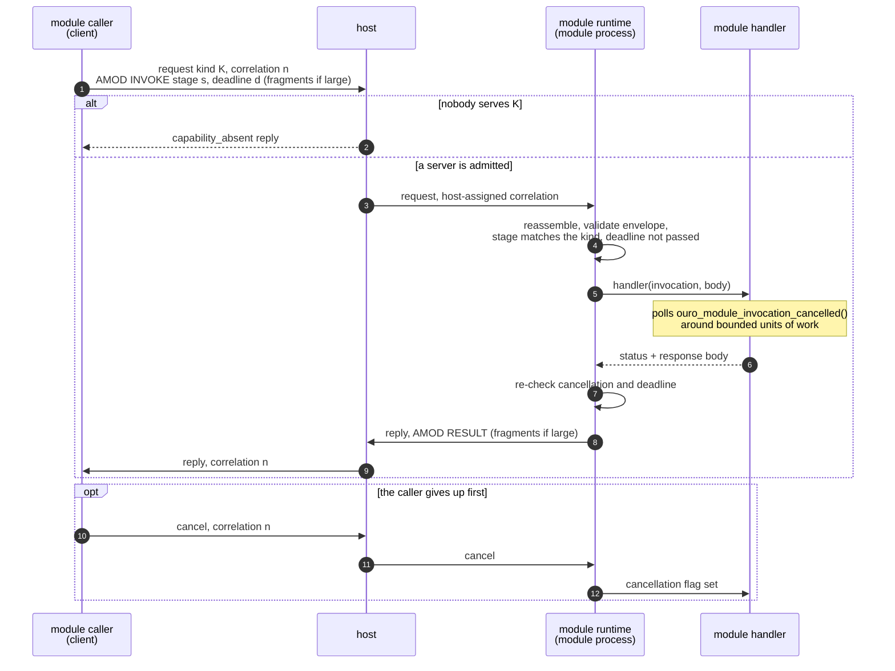
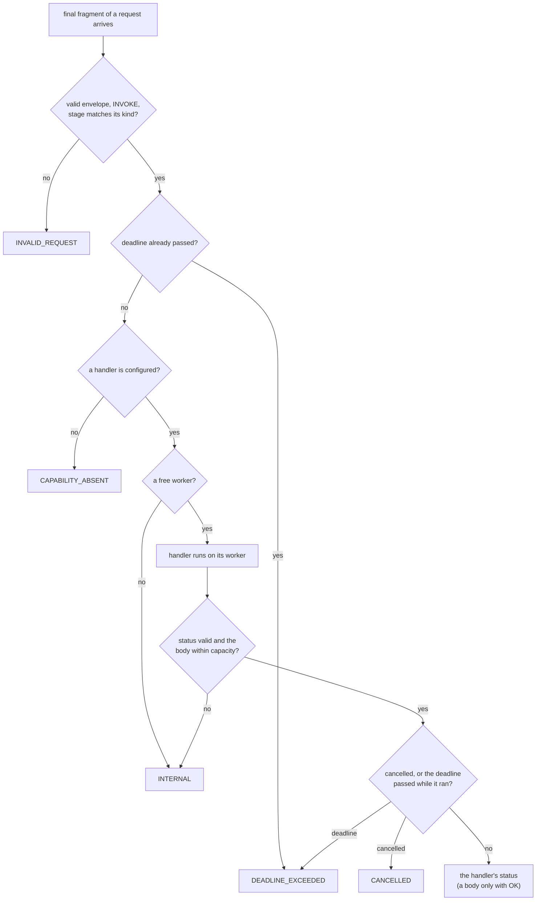

# Module calls

A module call is a request/reply on the ring with a fixed envelope inside the
payload. The ring frame carries routing, correlation and cancellation; the
envelope, called AMOD, says which stage of a module is being invoked, by when,
and with what outcome. Both halves come with the reference implementations: a
**module runtime** a module process runs to serve stages, and a **module
caller** a client uses to invoke them. Neither side needs the other's code,
only the envelope.

## The AMOD envelope

Every request and reply payload starts with a 40-byte little-endian header
(`<ouroboros/module_protocol.h>`; offsets are frozen in
[`vectors/layout_vectors.tsv`](../vectors/layout_vectors.tsv)):

| Field | Meaning |
|---|---|
| magic | `AMOD` (`0x444f4d41`) |
| version | 1 |
| operation | `INVOKE` (1) on a request, `RESULT` (2) on a reply |
| status | on a reply: `OK`, `CAPABILITY_ABSENT`, `CANCELLED`, `DEADLINE_EXCEEDED`, `INVALID_REQUEST` or `INTERNAL` |
| stage_id | which of the module's stages, nonzero |
| flags | reserved, zero |
| body_len | bytes of body in this frame, after the header |
| deadline_ns | an absolute `CLOCK_MONOTONIC` deadline; zero means none |
| trace_id | opaque, carried from request to reply |

The envelope has no pointers, native structs or host-endian fields, so every
language implements it from the table alone. A module defines what its stage
bodies mean; the ring does not.

**Large bodies.** A frame holds at most `inline_budget` bytes. A larger body is
split into ordered fragments under one correlation id, each carrying its own
AMOD header and the next slice of the body, with `OURO_F_MORE` on every fragment
but the last. The receiving side reassembles them, up to 16 MiB per message
(`OURO_MODULE_MESSAGE_MAX_BODY`).

## A call, end to end



## The module runtime (serving)

A module provides a table of `(event_kind, stage_id)` pairs and one handler. The
runtime owns everything else: attaching as the module's principal, heartbeats,
envelope validation, reassembly, deadlines, cancellation, replies that keep the
caller's correlation, and an orderly stop.

```c
static const ouro_module_stage_t stages[] = {{4353u, 1u}, {4354u, 2u}};

static ouro_module_status_t handle(const ouro_module_invocation_t *call,
                                   const uint8_t *request, uint32_t request_len,
                                   uint8_t *response, uint32_t capacity,
                                   uint32_t *response_len, void *user_data);

int main(int argc, char **argv)
{
   const ouro_module_process_config_t config = {
       .socket_path = argv[1],
       .module_name = "example",
       .principal_class = 1u,
       .principal_ref = 17u,
       .stages = stages,
       .stage_count = sizeof stages / sizeof stages[0],
       .handler = handle,
   };
   return ouro_module_process_run(&config); /* until SIGINT/SIGTERM or an epoch change */
}
```

- **What a request must be.** The runtime refuses, with `INVALID_REQUEST`, a
  request whose envelope does not decode, whose operation is not `INVOKE`, whose
  stage does not match the stage registered for its kind, or whose fragments
  disagree about stage, deadline, trace or sender. It never calls the handler
  for those.
- **Concurrency.** Each request runs on its own worker thread, up to a fixed
  number in flight; past that the runtime answers `INTERNAL` instead of
  queueing.
- **Cancellation and deadlines.** A ring cancel for the correlation, or the
  deadline passing, sets the invocation's cancellation flag. The handler checks
  it with `ouro_module_invocation_cancelled`; the runtime checks again before
  it replies. Module code owns no clocks and no transport cancellation.
- **Identity.** `source_principal_ref` and `source_handle` in the invocation
  come from the host-stamped frame, never from the request body, so a handler
  can trust who called it.
- **Embedding.** `ouro_module_service_run` serves the same stages over a client
  the caller already attached, without installing signal handlers. A host uses
  it to serve stages from inside its own process.

The Go (`ring.RunModuleProcess`) and Rust (`run_module_process`) runtimes follow
the same contract, and a module in either is held to the same C harness
(`c/conformance/module_runtime.c`).

## The module caller (calling)

`ouro_module_client_call` (`<ouroboros/module_client.h>`) makes one synchronous
call over a client dedicated to calling:

```c
uint32_t len = 0;
ouro_module_call_result_t r = ouro_module_client_call(
    &caller, 4353u, 1u, trace_id, deadline_ns, request, request_len,
    response, sizeof response, &len, cancelled, cancel_ctx);
```

It assigns the correlation id, encodes the envelope and fragments, waits for
the reply while polling the caller's `cancelled` callback, sends a ring cancel
and returns `CANCELLED` or `DEADLINE_EXCEEDED` when either fires, and ignores a
late reply to an earlier call on the next one. The outcome is one of:

| Result | Meaning |
|---|---|
| `OK` | the handler returned OK; the full body is in `response` |
| `CAPABILITY_ABSENT` | no admitted process serves the kind, or the handler said so |
| `CAPABILITY_DENIED` | this caller is not granted that request kind |
| `CANCELLED`, `DEADLINE_EXCEEDED` | the caller's own cancellation or deadline fired |
| `INVALID_REQUEST`, `INTERNAL` | the handler's verdict |
| `RESPONSE_TOO_LARGE` | the full body did not fit `response`; nothing partial is copied |
| `TRANSPORT`, `PROTOCOL` | the ring failed, or the reply was not a valid envelope for this call |
| `INVALID_ARGUMENT` | the call itself was malformed |

One module client makes one call at a time. A C process that makes many calls
at once attaches several of its own clients and pools them
(`ouro_module_client_pool_t`, since 0.1.3): each call checks out a free client
and returns it after. A caller that finds every client busy waits only within
its own deadline (30 seconds when it has none) and gets `DEADLINE_EXCEEDED`
rather than queueing without end; `ouro_module_client_pool_stop` refuses new
calls with `TRANSPORT` and cancels those in flight; `ouro_module_client_pool_peak`
reports the most calls in flight at once, so a pool that peaks at its size is
serializing its callers. The pool is a convenience of the C implementation, not
part of the contract.

Go has `ring.NewModuleCaller` and, for many goroutines sharing one client,
`ring.NewConcurrentModuleCaller`; Rust has `ModuleCaller`. All three map
outcomes to the same results, which `OURO_TEST_MODULE_CALLER` checks across
languages.

## Statuses at a glance

How the reference runtime arrives at the status of a reply:



A cancel or an expired deadline replaces whatever the handler returned, so a
caller never receives a result for a call it has already given up on.
