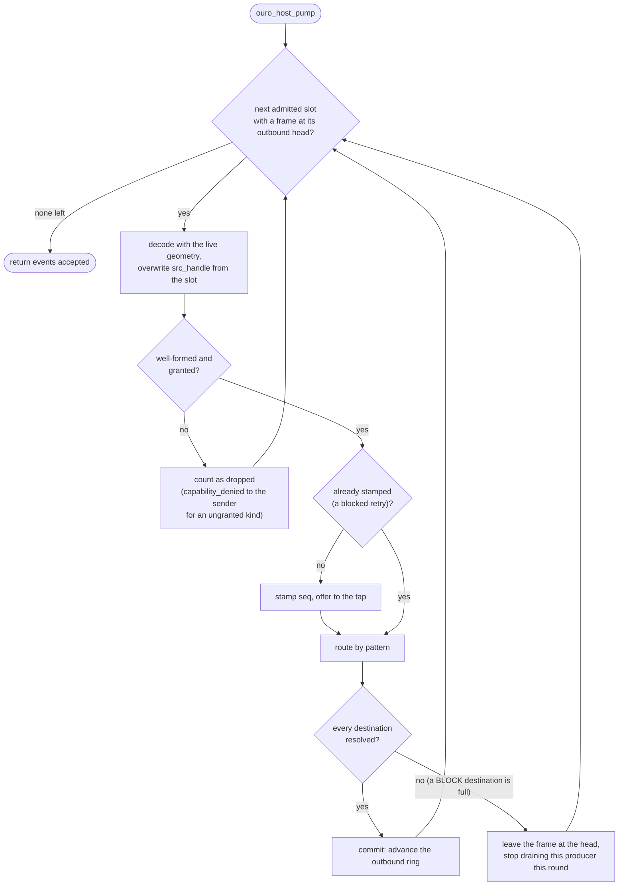
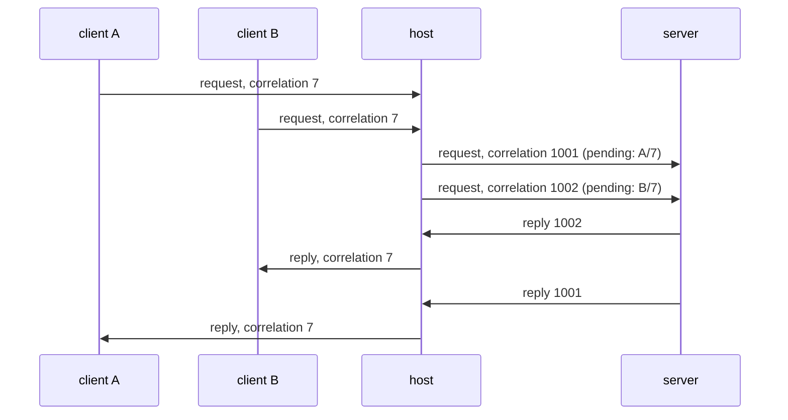
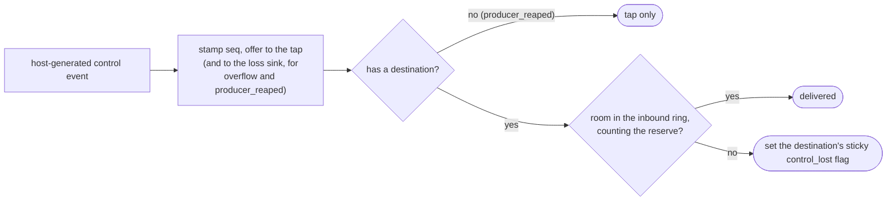

# Routing and flow control

The host is the only participant that moves an event from one client to
another. This page describes what it does with each event it drains, how a full
destination is handled, and how every loss becomes an event of its own. The
rules are [D5](../spec/decisions.md#d5-backpressure-block-by-default-per-client-never-silently)
and [D6](../spec/decisions.md#d6-the-tap-records-the-intended-stream-sheds-are-events);
the implementation is `c/src/route.c`.

## The pump

`ouro_host_pump` drains every admitted client's outbound ring once and returns
the number of events it accepted. The embedding calls it, under the same lock it
uses for attach and reap; the ring runs no thread of its own for routing.

Each event is stamped and tapped exactly once, the first time the host sees it.
A blocked event stays at the head of its producer's ring and is retried on the
next pump; the host remembers which destinations already received it, so a
retry never delivers twice.

## Routing by pattern

| Frame | Goes to | If there is nobody |
|---|---|---|
| notification | every slot subscribed to the kind | delivered to no one (it was still stamped and tapped) |
| request | the kind's single serving slot | the requester gets a synthesized `capability_absent` reply |
| reply | the requester only, by the pending-request table | dropped: no matching request, or a reply from a slot that was not its server |
| cancel | the server of the outstanding request | dropped; cancel is best-effort and idempotent |

Subscription is the authorization: a client never receives a kind it is not an
observer of. A kind has at most one server; a second `ouro_host_serve_kind` for
it is refused.

**Correlation ids.** Each client picks correlation ids for its own requests, so
two clients calling the same server will eventually choose the same number. The
host keeps a pending entry per outstanding request holding both the requester's
id and a host-assigned id that is unique across the ring. A request is rewritten
to the host id on its way to the server, and the reply is rewritten back on its
way to the requester. Each caller sees only its own numbering, and the server
can key its work on an id nobody else is using.

**Fragments.** A request or reply too large for one slot travels as ordered
inline fragments under one correlation id: every fragment but the last sets
`OURO_F_MORE`. The host keeps the pending route open until both directions have
finished, and a cancel retires a partial stream
([wire spec: message patterns](../spec/wire-and-segment.md#message-patterns)).

**Arena payloads** route by reference. A notification's lease is published to
exactly the observer set at first sight, a request's or reply's to its single
destination; the host forwards the lease, never the bytes. See
[arena payloads](arena-payloads.md).

## Full destinations

Rings are bounded, and the host never keeps a queue of its own. When a
destination's inbound ring is full, the kind's policy decides what happens, for
that destination only:

- **BLOCK** (the default). The event stays at the producer's outbound head. The
  host holds at most one such event per producer, so the cost is bounded by the
  number of slots, not by traffic. The producer's ring stops draining, its next
  publish finds the ring full and returns `would_block`, and the slow consumer
  holds back exactly the producers that send it block-policy kinds, and nobody
  else.
- **SHED** (opt in per kind with `ouro_host_set_kind_policy`). The destination
  is skipped and sent an `overflow` event naming the shed event's `seq`, kind and
  the destination slot. Delivery to the other destinations continues.

Fan-out is therefore not atomic, and that is the contract: delivery to each
destination of one event is independent, and every destination that missed it
is told.

Publishing returning OK means the frame was accepted into the caller's own
outbound ring. It never means delivered.

## Control-class events and the reserve

The host generates a few events of its own: `overflow`, `producer_reaped`,
`capability_absent` and `capability_denied`. They carry `OURO_F_CONTROL` and
differ from ordinary traffic in two ways, both there to stop a notice about
loss from itself being lost:

- Ordinary traffic may not use the last few inbound slots of each ring (the
  `control_credits` reserve in the queue pair); control events may. A client
  saturated with data still has room to be told it lost some.
- Control events are never shed. If even the reserve is full, the host sets the
  destination's sticky `control_lost` flag, which the client reads with
  `ouro_client_control_lost`.

`producer_reaped` is tap-only: it describes a client that no longer exists, so
there is nobody to deliver it to.

## The tap and the loss sink

The tap (`ouro_host_set_tap`) is called for every event the host accepts,
exactly once, in `seq` order, before routing. A frame refused at the producer's
own ring (`would_block`) was never accepted and is not tapped, so the tapped
`seq` values are contiguous. The capture recorder is a tap
([capture](capture.md)).

The loss sink (`ouro_host_set_loss_sink`) is a second, rare observer: it is
called only for `overflow` and `producer_reaped`. An embedding that must keep
loss evidence durable can do that work there, off the per-event path.

## What a consumer can rely on

- Events from one producer arrive in the order it published them.
- Order across producers is the host's `seq`, and only the tap sees all of it.
  A consumer's own `seq` values are sparse by design, since it only observes some
  kinds, so a gap there means nothing; loss is reported by `overflow`, never
  inferred from `seq`.
- The delivered stream can be derived from the tapped one: everything tapped,
  minus the sheds and `producer_reaped` discards the stream itself records.
