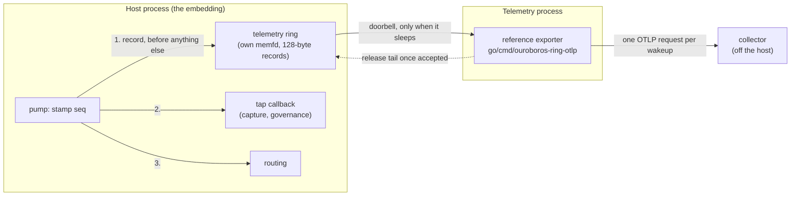
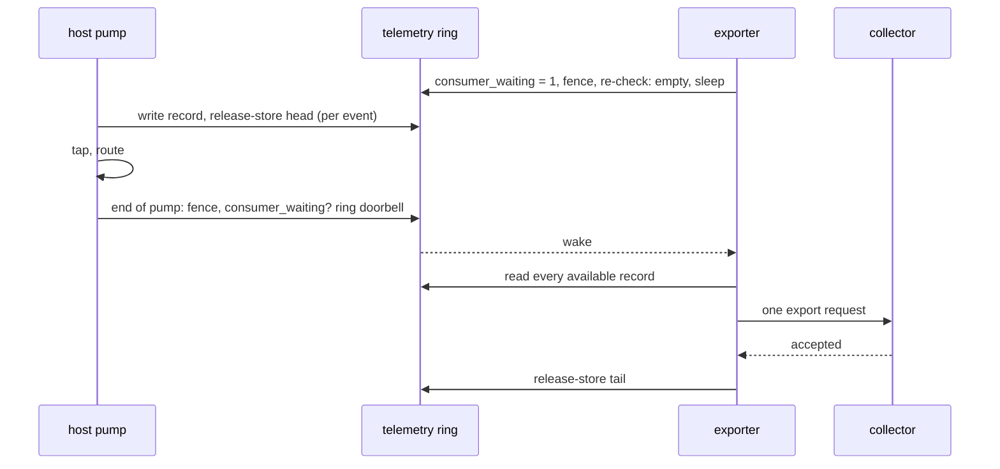

# Telemetry

Every event the host stamps is described off the host the moment it is
stamped ([D16](../spec/decisions.md#d16-tap-telemetry-leaves-the-host-the-moment-an-event-is-stamped)).
The host writes one record per event into a ring that only one process reads,
and that process sends the records to a collector. The host never waits for it,
never talks to a network, and, with the consumer paced, pays about 5 ns per
event for the hand-off (measured on one machine; see [Pacing](#pacing)).



## What a record holds

A record is 128 bytes: a type (event or gap), a `CLOCK_REALTIME` timestamp, a
lost count for gaps, and the stamped 64-byte frame header encoded exactly as on
the wire. That header carries `seq`, kind, pattern and placement, the attested
`principal_ref`, the source handle, the correlation id and the payload length.
**No payload byte is ever in a record**, so nothing the collector receives can
contain content. The exact layout is in `vectors/layout_vectors.tsv`
(`telemetry.*`, `telemetry_record.*`).

The clock is read once per pump, at its first stamp. Records in one pump share
that time, and `seq` orders them exactly.

## The hand-off



- **Per event, the host** stores the record's fields directly into its slot and
  publishes it with one release store. It reads the consumer's `tail` across
  cores only when its cached copy says the ring is full.
- **Per pump, the host** rings the doorbell once, and only if the exporter is
  asleep (the [D13](../spec/decisions.md#d13-doorbells-idle-ends-sleep-in-the-kernel)
  protocol). A busy host whose exporter keeps up makes no system call for
  telemetry. An event stamped outside a pump, such as the `producer_reaped` a
  reap emits, rings it at once.
- **The exporter** has no batching timer. A wakeup sends everything available
  in one request; what arrives while that request is in flight goes in the
  next. It releases records only once the collector accepts them, so delivery
  is at least once and `seq` identifies a duplicate.

## Pacing

A consumer woken for every pump costs the host a system call per pump, and it
reads each record right behind the host writing it, so every record's cache
lines move between cores. The host therefore publishes two values in the
region header, and every reader's wait follows them:

| Field | Default | Meaning |
|---|---|---|
| `drain_interval_ns` | 10 µs | while busy, the consumer looks again this often |
| `idle_after_ns` | 1 ms | with no records this long, it sleeps on the doorbell |

A consumer that found records recently keeps `consumer_waiting` down and drains
on the interval, so a busy host never rings it and is never read right behind.
Once idle, it sleeps on the doorbell as before, so an idle ring costs nothing
and the host rings only a consumer that is actually asleep. A record leaves at
most one drain interval after it is stamped while the host is busy.

The host operator sets them with `OURO_TELEMETRY_DRAIN_INTERVAL_US` and
`OURO_TELEMETRY_IDLE_AFTER_US` (read when telemetry is enabled); an embedding
can call `ouro_host_telemetry_pacing`. A drain interval of 0 has every wait
sleep on the doorbell.

Measured with `c/bench/dispatch.c` on a Threadripper 3970X, both threads pinned
to their own cores, 2 million events per run:

| | ns per event | doorbell writes |
|---|---|---|
| telemetry off | 127 | – |
| on, paced (default) | 132–133 | 0–2 |
| on, pacing off, one CCX | 144 | ~30,000 |
| on, pacing off, across CCXs | 157 | ~30,000 |

These compare only on one machine with the same pinning
(`OURO_BENCH_HOST_CPU`, `OURO_BENCH_DRAIN_CPU`). `scripts/check_perf_budget.sh`
also holds the doorbell-write count for a busy consumer under a ceiling, a
check that means the same on every machine.

## When the exporter falls behind

The host never blocks on telemetry. If the ring is full when an event is
stamped, the host counts the record lost (`dropped` in the region header, and a
pending gap count) and goes on routing. The next record that fits is preceded
by a gap record carrying the count, so the collector sees exactly how much is
missing and where. Telemetry loss never sheds, delays or reorders an event.

While the collector refuses or cannot be reached, the reference exporter backs
off from 100 ms to 5 s and retries the same records. That backoff is its only
timer.

If the exporter exits, the region stays with the host, and the next granted
exporter continues from the same `tail`. Nothing is lost unless the ring filled
in between.

## Granting it

The record is metadata about every principal on the ring, so who reads it is
the embedding's decision, never implied by admission:

```c
/* At startup, before clients may attach. 0 = 65536 records (8 MiB). */
ouro_host_telemetry_enable(&host, 0);

/* In the attach hook, for the one principal trusted with it. */
static ouro_attach_status_t hook(void *ctx, ouro_host_t *h, uint32_t slot,
                                 const ouro_attach_request_t *req)
{
   if (req->principal_ref == MY_EXPORTER_PRINCIPAL)
      ouro_host_grant_telemetry(h, slot);
   return OURO_ATTACH_OK;
}
```

A host that admits through the runtime listener says it in the exporter's
grant file instead: `telemetry=yes`.

The host hands the consumer end (`OURO_ATTACH_CAP_TELEMETRY`, two more
descriptors after the doorbell pair) only to a granted slot that asked for it,
had a doorbell granted, and while no other live slot holds it.

## The reference exporter

`go/cmd/ouroboros-ring-otlp` is in the ring's Go module, so a consumer builds
it at the release it already pins:

```sh
go build github.com/RakuenSoftware/ouroboros-ring/go/cmd/ouroboros-ring-otlp
```

Its core is the package `go/otlpexport`, for an embedding that applies its
own collector policy or identity and runs `otlpexport.New(...).Run` in a
process of its own. The `ring` package imports none of its OpenTelemetry
dependencies, and
`scripts/check_go_no_cgo.sh` fails the build if it ever does. It sends OTLP/HTTP
logs, one log record per ring record:

| OTLP field | From |
|---|---|
| event name | `ouro.ring.event`, `ouro.ring.gap`, or `ouro.ring.malformed` |
| timestamp | the record's `realtime_ns` |
| severity | info; warn for `overflow`, `producer_reaped`, `capability_denied` and gaps |
| `ouro.seq`, `ouro.event.kind`, `ouro.message.type`, `ouro.payload.placement`, `ouro.payload.bytes`, `ouro.principal_ref`, `ouro.source.handle`, `ouro.control` | the frame header |
| `ouro.correlation_id`, `ouro.destination.handle` | when set |
| `ouro.lost` | gap records |

```sh
OTEL_EXPORTER_OTLP_LOGS_ENDPOINT=https://collector:4318/v1/logs \
  ouroboros-ring-otlp -socket /run/my-host/ring.sock -principal-ref 0x7E1E
```

Endpoint, headers, TLS and timeouts come from the standard
`OTEL_EXPORTER_OTLP_*` variables. It exits 3 when the host goes away (it holds
the host's pidfd, [D15](../spec/decisions.md#d15-liveness-is-the-process-not-a-timer)),
so a supervisor restarts it against the new host.

Any process in any language can be the exporter instead: the region, record and
grant are the contract, and the C (`ouro_client_attach_telemetry`,
`ouro_telemetry_*`) and Go (`ring.AttachTelemetry`, `ring.ConnectTelemetry`,
`ring.TelemetryReader`) clients both read them.
