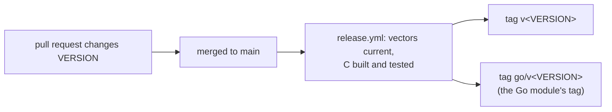

# Versions and releases

Two kinds of version describe the ring: the version of this repository's
releases, and the versions of the contract itself. They change for different
reasons and are checked in different places.

## Release versions

`VERSION` holds the repository's release in semver. Within 0.x a minor bump may
break consumers; from 1.0 only a major bump may.

A change to `VERSION` on `main` is checked (the vectors against their
generators, the C build and its tests) and tagged by
`.github/workflows/release.yml`: `v<VERSION>` for the repository and
`go/v<VERSION>` for the Go module, which lives in the `go/` subdirectory. A tag
is never moved. Consumers name a release, or a compatible range of releases,
never a commit.

| Language | How a consumer pins a release |
|---|---|
| C | build and install a tagged source tree with its own CMake build (`find_package(ouroboros-ring)`, targets `ouroboros::ouroboros-ring` and `ouroboros::ouroboros-ring-client`, or pkg-config `ouroboros-ring` / `ouroboros-ring-client`) |
| Go | `go get github.com/RakuenSoftware/ouroboros-ring/go@v<VERSION>`, import `github.com/RakuenSoftware/ouroboros-ring/go/ring` |
| Rust | `ouroboros-ring = { git = "https://github.com/RakuenSoftware/ouroboros-ring", tag = "v<VERSION>" }` |

A consumer that builds the C libraries from a release should check the release
tree's content against a digest it recorded, since a tag is only a name.
Compiler workarounds the ring's own code needs live in the ring's CMake build,
so a consumer gets them by using that build rather than compiling the sources
itself.

## Contract versions

The contract carries its own numbers, frozen in `vectors/layout_vectors.tsv`:

| Version | Answers | Changes when |
|---|---|---|
| `version.spec` | which specification this is | the specification is revised |
| `version.layout` | can I map these regions? | a region's or ring header's structure changes: a field added, moved or removed |
| `version.wire` | can I decode these frames? | the frame header changes; negotiated per attach |
| `version.amod` | can I read this module envelope? | the AMOD envelope changes |

Some changes need none of these:

- **Geometry** (`slot_size`, `inline_budget`, `arena_size`, ring capacity) is a
  parameter the client reads at attach, not part of any layout, so re-tuning it
  bumps nothing
  ([D4](../spec/decisions.md#d4-slot-size-and-inline-budget-control-region-parameters-not-wire-fields)).
- **Additions in reserved space** are announced by a control-region flag that
  older readers ignore, so `layout_version` stays put. The lease view (D12) was
  added this way: `OURO_CONTROL_F_LEASE_VIEW`, with its slot count and offset in
  fields that every earlier host left zero. So were doorbells (D13):
  `OURO_CONTROL_F_DOORBELL`, the two waiting flags, and an attach request that
  grew by a `capabilities` word an older host never reads. Process liveness
  (D15) is one more bit in that word and one reserved `client_heartbeat` value,
  `OURO_HEARTBEAT_DETACHED`, which no clock reading takes. Telemetry (D16) is
  a third bit, `OURO_ATTACH_CAP_TELEMETRY`, and a region of its own that only a
  client granted it receives, so no existing layout changes.

A host and client agree the wire version at attach
([attach and admission](attach-and-admission.md)). Capture files carry their
own `format_version`, independent of all of these
([capture](capture.md)).
